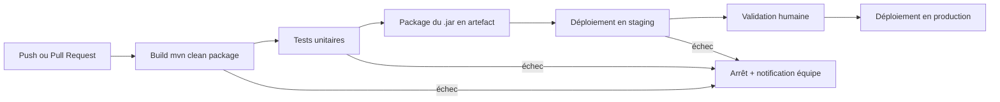

# TP 1 : Cartographier la livraison manuelle

Application : ERIS Inscriptions (Labo Academy)

## Étape 1 et 2 : actions manuelles et analyse

| N° | Action | Qui la fait ? | Durée estimée | Risque d'erreur (1 à 5) | Automatisable ? | Phase |
|----|--------|---------------|---------------|--------------------------|-----------------|-------|
| 1 | Récupérer la dernière version du code | Développeur | 2 min | 2 | Oui | CI |
| 2 | Vérifier la version de Java installée | Développeur | 1 min | 3 | Oui | CI |
| 3 | Compiler le projet | Développeur | 2 min | 2 | Oui | CI |
| 4 | Lancer les tests unitaires | Développeur | 3 min | 4 | Oui | CI |
| 5 | Corriger ou ignorer les tests en échec | Développeur | 10 min | 5 | Non (décision humaine) | CI |
| 6 | Construire le .jar (mvn clean package) | Développeur | 3 min | 2 | Oui | Delivery |
| 7 | Nommer et versionner le fichier .jar | Développeur | 2 min | 4 | Oui | Delivery |
| 8 | Se connecter au serveur (SSH) | Développeur | 2 min | 2 | Oui | Deployment |
| 9 | Copier le .jar sur le serveur | Développeur | 5 min | 3 | Oui | Deployment |
| 10 | Arrêter l'ancienne version de l'application | Développeur | 2 min | 4 | Oui | Deployment |
| 11 | Lancer la nouvelle version | Développeur | 2 min | 4 | Oui | Deployment |
| 12 | Vérifier que l'application répond | Développeur | 3 min | 3 | Oui | Deployment |
| 13 | Prévenir l'équipe que la livraison est faite | Développeur | 2 min | 3 | Oui | Hors phase |
| 14 | Revenir à la version précédente si problème (rollback) | Développeur | 15 min | 5 | Oui | Hors phase |

## Étape 3 : classement

- **CI (build et tests)** : actions 1 à 5.
- **Delivery (production de l'artefact)** : actions 6 et 7.
- **Deployment (mise en ligne)** : actions 8 à 12.
- **Hors phase (oublis du processus)** : actions 13 et 14. La notification de l'équipe et le plan de retour arrière sont souvent oubliés dans une livraison manuelle.

## Étape 4 : pipeline cible

| Étape | Déclencheur | En cas d'échec |
|-------|-------------|----------------|
| Build | Push sur une branche ou ouverture d'une PR | Pipeline rouge, fusion bloquée, équipe notifiée |
| Tests | Réussite du build | Pipeline rouge, fusion bloquée |
| Package | Réussite des tests | Pas d'artefact publié |
| Staging | Fusion dans main | Arrêt, ancienne version conservée |
| Production | Clic d'un responsable (Delivery) | Retour automatique à la version précédente |

## Constat

Sur 14 actions manuelles, 13 sont automatisables. La seule qui reste humaine est la décision face à un test en échec, ce qui est voulu : le pipeline s'arrête et l'équipe tranche.